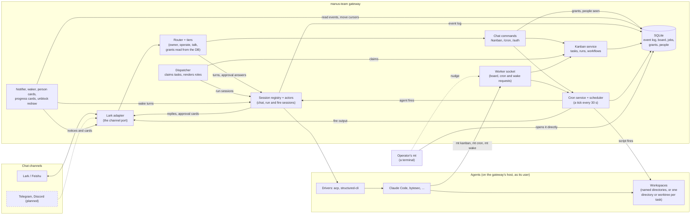

# manus-team

manus-team runs a team of AI agents from Lark (Feishu) today, with Telegram, Discord and more
planned. You chat with an agent in any group or direct message, and you give work to roles,
such as an analyst, a reviewer or a report author, on a kanban board. Each role's agent works
in its own workspace, a directory on the gateway's host, and reports back in the task's thread.
A task can be any work: research, a document, an operation in Lark, a chore, or a change to
code.

## Channels

| Channel | Status |
|---|---|
| Lark / Feishu | Built: chat, streaming reply cards, threads, buttons, approvals |
| Telegram | Planned |
| Discord | Planned |
| Others (Slack, a web page, …) | Possible later |

A channel is one adapter behind the gateway's channel port, [src/channel/types.ts](src/channel/types.ts).
It receives messages and button presses, and sends text, cards, card updates and reactions.
Chat, reply cards, approvals, the board's notices and person cards, wakes, progress cards and
cron jobs all build on that port. An adapter also has to give threads or an equivalent, where a
task's conversation lives; a stable person id, as Lark's union_id is; a message id, so a
repeated delivery is dropped; sends that a repeated key does not post twice; and a group's
members, without which person cards go by direct message. Some code above the port is Lark's
today: a person is `lark:<union_id>`, the configured tiers are by open_id, failures are told
apart by Lark's error codes, a few places write or check the channel name `lark`, and the
gateway starts one Lark adapter only. A second channel needs that work first.

## What you can do

Each item has an example of what you would type. In a group, start a message with an
@-mention of the bot; in a direct message, just type.

- **Chat with an agent.** Plain text starts or continues a session, and the answer streams into
  a card. `/status`, `/stop` and `/new` steer it.
  Example: `@bot What changed in the API since Monday?`
- **Give work to a role on the board.** A task names its role, and optionally a reviewer, a
  contract and gates, commands that must pass before the work counts as done. A failed run is
  retried, then the task blocks for a person. Examples: `/kanban task new Summarise the vendor
  contracts` with a line `assignee: worker`, a line `reviewer: reviewer`, and
  `/kanban gate add k_7gq2 test -s notes/contracts.md`.
- **Run workflows.** A YAML file in `$MT_HOME/workflows/` turns into a graph of tasks with
  their links, made at once. `for_each` makes one task per item of a list, and `board:` says
  which board the tasks go on.
  Example: `/kanban workflow start vendor-eval topic="log storage" vendors=acme,globex`
- **Schedule cron jobs.** With `cron.enabled: true`, at its time the gateway gives a role's
  agent a prompt and posts the answer in the chat.
  Example: `/cron add "every weekday 09:00" worker List the open PRs and how old they are.`
- **Wake an agent when a task ends.** With wake on, a task's outcomes (done, changes
  requested, blocked, given up, stranded) start a turn of the agent that follows the thread. For
  a block the agent could lift, it gets the first try before people get an Unblock button. A wake
  can also name a role, which then gets a reaction task. Examples: a line `wake: on` on
  `/kanban task new`, or `/kanban task wake k_7gq2 coordinator`.
- **Watch runs live.** A progress card shows each long run's tools, the agent's latest words
  and a Stop button. It is off by default.
  Example: `kanban.progress.enabled: true` in the config file.
- **Let people in, by tier.** The owner, set in the config, can do everything; operate tier
  changes the board and answers approvals; talk tier chats and reads. Examples:
  `/auth grant @Carol Wu talk`, and `/role list` to see who does what.
- **Use `mt` at the terminal.** The same board, roles, workspaces, cron jobs, grants and the
  service, plus deploys. Examples: `mt kanban task list` and `mt update`.

## An example thread

An illustration of a task with wake on, in a group's thread. The bot's lines use the gateway's
own wording; the task, the agent's words, the names and the times are made up, and the
next run's own progress card is left out.

```text
Alice: /kanban task new Book the venue for the March offsite
       assignee: worker
       wake: on
       Find a venue in Lisbon for 40 people, 12 to 14 March. Deposits under 3,000 EUR are fine.
Bot:   Created k_7gq2: Book the venue for the March offsite, for role worker. This thread hears
       when it is done, needs review, has changes requested, blocks, is retried after a failure,
       gives up or is stranded. Its outcomes wake the agent here.
Card:  ⚙️ Book the venue for the March offsite k_7gq2
       worker · run 1 of 2 · running 4 min
       ✅ Read ×3 · ⏳ Bash
       > Two venues have the dates free; the cheaper one asks for a deposit.
Bot:   Book the venue for the March offsite k_7gq2 is blocked (needs_input): The cheaper venue
       wants a 2,000 EUR deposit by Friday. May I hold it?
       /kanban task unblock k_7gq2 [comment] once it can go on.
       The agent is looking at it first.
Card:  (drawn final) ⏸ blocked after 6 min 12 s
Bot:   Waking the agent for 1 board update.
Agent: (woken by the board, as Alice) The brief allows deposits under 3,000 EUR, so I unblocked
       k_7gq2 with "Hold it; the brief allows it."
Bot:   (the block's notice is redrawn, ending)
       k_7gq2: Unblocked by Alice (woken by the board) at 10:42
Bot:   Done: Book the venue for the March offsite k_7gq2
       > Held Casa do Rio for 12 to 14 March; deposit due Friday.
Bot:   Waking the agent for 1 board update.
```

## Status and limits

- **Lark is the only channel.** Other chat channels are planned, not built.
- **Two agent drivers.** `acp` (the default) speaks the Agent Client Protocol, for agents such
  as `claude-agent-acp`, and is the only driver with approval cards. `structured-cli` runs one
  process per turn and reads JSON back; it is written for bytesec's `run --format json`, acts
  with no approvals, and needs `agent.unsupervised: true`. Both have been run in real use:
  Claude Code (`claude-agent-acp`) over `acp`, and bytesec over `structured-cli`. The test
  suite drives each driver end to end with a fake agent. See [Protocol strategy](#protocol-strategy).
- **A restart ends live agent runs.** The broker that would keep agents alive across a gateway
  restart is designed, not built. A board run cut short by a restart is retried quietly; a chat
  session's history survives and resumes on the next message.
- **The agent is not sandboxed.** It runs as the same user as the gateway, so it can read
  anything on disk that user can. Keep credentials in the `.env` files or the environment, as
  [Configuration](#configuration) says.
- **Wake and progress cards are new.** Both are built and tested, and their smoke checklists
  against a live Lark tenant are still to be run: section 15 of the
  [wake design](docs/specs/2026-11-19-wake-design.md) and of the
  [progress cards design](docs/specs/2026-11-24-progress-cards-design.md).

## How it fits together



A Lark message reaches the router through the channel adapter. The router checks the sender's
tier, counting any grant held in the database, then hands a turn to its chat's session, or a
command such as `/kanban`, `/cron` or `/auth` to that command's handler. Every agent runs in a
session opened through the one session registry: a chat's, a board run's that the dispatcher
opens for a task it claims, and a cron fire's; a run's session posts into a sink that forwards
only a supervised agent's approval cards to the chat following its task, and a fire's posts
nothing, the scheduler sending the fire's output itself. The board's loops read its events from
the database and post to Lark, and the waker wakes an agent with a turn in its chat's own session.
An agent's shell reaches the gateway through the worker socket, while the operator's `mt` opens
the database itself and nudges the gateway over the socket after a change.

## Quick start

1. Create a Lark app with the bot's permissions and events: [Feishu/Lark app setup](#feishulark-app-setup).
2. Run `./install.sh` in a checkout (Node 22.12 or later): [Installing](#installing).
3. Set `lark.appId`, `auth.owner` and a workspace in `~/.manus-team/config.yaml`, and
   `LARK_APP_SECRET` in `~/.manus-team/.env`: [the configuration guide](docs/configuration.md#1-the-minimum-to-start).
4. Make roles with `mt role create`, check them with `mt role check`, and set
   `kanban.enabled: true` for the board: [Roles and workspaces](#roles-and-workspaces).
5. Start it with `mt service install`, then message the bot: [Running as a service](#running-as-a-service).

## Where to read more

- [The board guide](docs/kanban-guide.md): a walk-through from one task to chains, review,
  workflows, wakes and cron, with messages to paste.
- [The configuration guide](docs/configuration.md): the setup step by step, from the minimum
  that starts to each feature turned on, and the full reference of every setting.
- [The cookbook](docs/examples.md): workflows and cron jobs ready to copy.
- [The board's skill](skills/mt-kanban/SKILL.md): how an agent works the board well, in a run, a
  chat or a woken turn; a role turns it on with `agent.skills: [mt-kanban]`
  ([how](docs/kanban-guide.md#the-boards-skill)).
- The specs in [docs/specs/](docs/specs/): the [Lark channel](docs/specs/2026-08-21-lark-channel-design.md),
  the [board](docs/specs/2026-11-02-kanban-design.md), [workflows](docs/specs/2026-11-16-workflows-design.md),
  [cron](docs/specs/2026-11-16-cron-design.md), [tier grants](docs/specs/2026-11-18-tier-grants-design.md),
  [wake](docs/specs/2026-11-19-wake-design.md) and [progress cards](docs/specs/2026-11-24-progress-cards-design.md).
- [The architecture](docs/architecture.md), and [Design](#design) below for the ideas behind it.
- The rest of this README: [Running it](#running-it), [Chat commands](#chat-commands),
  [The board from Lark](#the-board-from-lark), [Cron jobs](#cron-jobs) and [The mt command](#the-mt-command).

## Running it

Requires Node 22.12+ and, on `PATH`, an agent the configured driver can run: an ACP agent,
such as `claude-agent-acp`, for `acp`, or bytesec, or another CLI that writes the same JSON stream, for
`structured-cli`.

### Installing

From a checkout:

```bash
./install.sh            # build, make ~/.manus-team, put mt on PATH
./install.sh --service  # the same, then mt service install
```

Stop an `npm run dev` gateway from this checkout first: `npm ci` replaces `node_modules` under
the running `tsx watch`.

`install.sh` is safe to run again. It:

- picks nvm's newest node 22 (22.12 or later) when nvm has one, else the `node` on `PATH`, or
  the one `--node <path>` names, and the `npm` beside it;
- runs `npm ci && npm run build`;
- creates `$MT_HOME` (default `~/.manus-team`) owner-only, and `config.yaml` from
  `config.example.yaml` when there is none. It never overwrites a config;
- prints the line that creates the `.env` when there is none (see "Configuration" below). It
  never asks for the secret and never prints it;
- writes `$MT_HOME/bin/mt`, the same launcher the gateway writes at each start: this checkout's
  `dist/mt.js` run by that node. It does not use `npm link`, which would put `mt` in one nvm
  version's global `bin`, beside every other global command, pointing at whichever checkout
  ran it last;
- prints the line that puts `$MT_HOME/bin` on `PATH`, and appends it, once, to `~/.zshrc` for
  zsh, or for bash to `~/.bash_profile` on macOS (whose terminals start login shells) and
  `~/.bashrc` elsewhere, only with `--yes` or when you answer yes at a terminal;
- copies the board's skill, `skills/mt-kanban/`, to `~/.agents/skills/mt-kanban/`, replacing
  only a copy it made itself, as `mt update` does after its backup. A role uses it once its
  config lists it in `agent.skills`.

To run it by hand instead: `npm ci && npm run build && npm start`. `npm run dev` runs the
source under `tsx watch`, which restarts at every change to it, a merge included.

### Running as a service

`mt service` runs the built gateway, `node dist/main.js`, as a LaunchAgent on macOS and a systemd
user unit on Linux, started at login and restarted when it fails:

```
mt service install      # write the unit, load it and start it
mt service status       # loaded, running, its pid, what it runs, the log, the pid lock
mt service logs [-f] [-n <lines>]
mt service start|stop|restart
mt service uninstall    # stop it and remove the unit; $MT_HOME is left as it is
mt service check        # would this build start as the service? install's check, without installing
```

`install` records the absolute path of the node running it, this checkout, and `PATH` as it is
in that shell, plus `MT_HOME` when it is set. Run it again to rewrite the unit, after changing
node or `PATH`, say. A home other than `~/.manus-team` gets a service of its own, named with a
hash of its path, so two homes never replace each other.

- **macOS:** `~/Library/LaunchAgents/team.manus.gateway.plist`, loaded with `launchctl
  bootstrap gui/<uid>`. `KeepAlive` restarts it when it exits other than cleanly, at most every
  30 seconds. `mt service restart` sends the gateway SIGTERM, waits up to 60 seconds for it to
  drain and exit, then starts it; `kickstart -k` only if it has not exited by then.
  `mt service stop` boots it out, since a killed job would be restarted; it loads again at the
  next login or `mt service start`. A LaunchAgent needs someone logged in at the Mac's console:
  over ssh alone there is no `gui/<uid>` domain, and `install` says so. macOS shows a
  "Background Items Added" notice for the new item; switching it off in System Settings >
  General > Login Items makes `launchctl bootstrap` fail until it is switched on again.
- **Linux:** `~/.config/systemd/user/manus-team.service`, with `Restart=on-failure` after 30
  seconds, but not after a configuration error (exit 78), which stays failed until it is fixed:
  see `mt service logs`. `KillMode=mixed` sends SIGTERM to the gateway alone, so it drains and
  stops its agents itself before systemd kills what is left. On a server, run `loginctl enable-linger $USER` once, or the user's
  services stop when you log out.

**Deploying.** The service runs `dist/`, so a merge does not restart it. A deploy is:

```bash
mt update            # show what's new on the branch, ask, then update and restart
mt update --check    # only show what's new; change nothing
mt update --yes      # no question, for scripts
```

`mt update` updates the checkout this `mt` runs from, which must be the one the service runs, on
the branch checked out, from the upstream that branch tracks
(`git branch --set-upstream-to=origin/main` names one). It refuses a checkout that is not clean,
or that has commits its upstream lacks. Before it changes anything it shows the commits, any new
migration, whether `npm ci` runs, how many agent runs a restart interrupts, and whether the
service is restarted. Then it fast-forwards, runs `npm ci` only when `package.json` or
`package-lock.json` changed or `node_modules/.package-lock.json` is missing, builds, and has the
new build check itself (`mt service check`). It backs the database up to `$MT_HOME/backups`,
owner-only (the five newest are kept, and the newest of each schema version). A failure of
`npm ci`, the build, the check or the backup goes back to the old commit and its build, and the
running gateway never notices. Then it restarts the service, and waits up to 60 seconds for the
log to say the gateway connected. If it does not, it prints the log's last lines and the steps
back, to take by hand: it never goes back by itself once the new gateway has the database. A
stopped service is left stopped. It exits 0 when done or up to date, 1 when it refused or went
back and nothing changed, and 3 when a person is needed, saying what to do; then its locks are
kept, so `mt update` run again gives that advice, never "up to date", until they are removed with
the `rm` it prints last. A build refuses a
database that a newer build migrated, with `configuration error:` and exit 78, so an old build
put back by hand stops rather than run on it: restore the backup of its version first.

A gateway run by hand (`npm run dev`, `npm start`) is not restarted, and `mt update` refuses while
one holds the home: stop it, run `mt update`, then start it again. With `kanban.enabled` off and no
service installed, such a gateway holds no lock for `mt update` to find, so stop it first yourself.
The deploy by hand is still:

```bash
git pull && npm ci && npm run build   # then restart the gateway
```

**The service has no shell environment.** It gets `PATH` and `MT_HOME` and nothing else you
exported, so:

- the secret must be in `$MT_HOME/.env`: `install` refuses without a `.env` that sets
  `LARK_APP_SECRET`. Any other `MT_*` or `LARK_*` setting this shell holds and the `.env` does
  not is a warning: put it in the `.env`;
- `install` loads the configuration as the service would, with only `PATH`, `MT_HOME` and the
  `.env`, and refuses when the gateway would not start on it, a missing `lark.appId` or owner,
  say, rather than load a unit sure to fail and be retried every 30 seconds;
- every `agent.passEnv` name, which forwards a variable from the gateway's environment, is
  missing there, and the gateway would refuse to start. `install` warns of each, without
  refusing, and
  `mt role check` warns of each this shell sets. Put the value in the role's `.env` and remove
  it from `passEnv`, or, for the `agent:` block, set `MT_AGENT_ENV_<NAME>` in the gateway's
  `.env`.

**Logs** go to `$MT_HOME/logs/gateway.log`, stdout and stderr both, owner-only in an owner-only
directory. Each run starts with `node --enable-source-maps`, so a stack names the TypeScript
source. When the gateway starts as the service and the log is over 10 MiB, it is copied to
`gateway.log.1`, owner-only, replacing the one before, and emptied in place, so every restart keeps it
bounded with no newsyslog or logrotate set up. A gateway that runs for months without a restart
is not rotated: restart it, or add a newsyslog (macOS) or logrotate (`copytruncate`) rule.

**Moving from `npm run dev`:**

1. Stop the `npm run dev` gateway. `install` warns while it holds `$MT_HOME/run/gateway.pid`,
   and the service cannot take the home until it stops.
2. Make sure `$MT_HOME/.env` sets `LARK_APP_SECRET`, and run `mt role check`: fix each
   `passEnv` warning.
3. `npm run build && mt service install`
4. `mt service status`, then `mt service logs -f` until it is connected.

To go back, `mt service uninstall`, then `npm run dev`.

### Feishu/Lark app setup

Create a custom app, then:

1. **Permissions:** the scopes the console lists for receiving and sending messages as the
   bot (`im/v1/messages`), downloading message resources for inbound attachments
   (`im/v1/messages/:message_id/resources`), and creating and updating cards
   (`cardkit/v1/cards`). With the board on, also `im:chat.members:read`, to read a group's
   members, so that a person's card can go in a task's thread in their group: without it,
   every card goes by direct message, and the log says so once.
2. **Events:** subscribe to `im.message.receive_v1` and `card.action.trigger`, delivered over
   **long connection** — no public URL, no request signing to get wrong.
3. Add the bot to a chat, or message it directly.

### Sending to Lark

Every message the gateway sends as one message — a reply or a notice of up to 4,000
characters, an approval card, a board card — goes through the SDK's own client with a uuid, and
Lark shows one message for any number of sends with the same uuid within an hour. This reaches every chat, with the board
on or off, and differs from the SDK's own send in three ways everyone sees:

- Replies and notices no longer go through the SDK's markdown tidying (headings demoted, blank
  lines compressed); they are sent as written.
- Texts over 4,000 characters, and streamed answers, still go out the SDK's way, without the
  uuid: a retry of one can still post a second copy.
- The fallback from a post to plain text is narrower than the SDK's: only a post Lark refuses
  as invalid content (230001) goes as text. A reply to a message that is gone — Lark's 230011
  or 230017, or an HTTP 404 — goes to its chat, as the SDK's does; 230020 is retried as the
  chat's rate limit instead.

**Before deploying this build at all (kanban off).** Run these steps of the smoke test at the
end of docs/plans/2026-11-05-plan-d2-kanban-people.md against the live tenant first, with
`kanban.enabled` off, and deploy only once they pass:

- the chat-session half of step 1: an approval card in a chat session, pressed and redrawn;
- step 8: one message per uuid, at chat scope and in a thread;
- step 11: a reply to a withdrawn message arrives in its chat;
- a `/help` reply in a direct message, in a group, and in a thread.

### Configuration

Settings live in a YAML file; credentials live in the gateway's `.env` or the environment.
[docs/configuration.md](docs/configuration.md) sets the gateway up goal by goal, from the
minimum that starts to each feature turned on, and holds the full reference of every key, with
its default, its limits and its environment variable. Start from
[`config.example.yaml`](config.example.yaml):

```bash
cp config.example.yaml ~/.manus-team/config.yaml
(umask 077; printf 'LARK_APP_SECRET=%s\n' "${LARK_APP_SECRET:?is not set}" > ~/.manus-team/.env) && chmod 600 ~/.manus-team/.env
```

Run that second line in a shell that already holds the secret: it writes the value without
printing it, refuses to write anything if `LARK_APP_SECRET` is not set, and the `umask` keeps
the file owner-only from the moment it exists. The `>` replaces an existing `.env` whole, so if
you already have one, add the line to it with an editor instead. If you set
`LARK_APP_SECRET` in the service's environment today, that is the whole migration: run the line,
run `mt role check` to see the file listed, then remove the variable from the service's
environment and restart. Until you remove it the environment's value is the one used.

**Where the file lives.** `$MT_HOME/config.yaml`, default `~/.manus-team/config.yaml`, or the
file `MT_CONFIG` names. A file that is named but missing is an error, while the default location
being absent is an ordinary environment-only deploy.

**Credentials go in the gateway's `.env`, the environment, or a role's `.env`.** The agent runs
as the same user and is not sandboxed in this build, so it can read anything on disk. The
environment is not airtight either (a same-uid process can read `/proc/<pid>/environ` on Linux),
but it does not persist, is not backed up, cannot be copied into a worktree, and cannot be
committed by accident. A key that looks like a credential (`secret`, `token`, `password`,
`apiKey`, …) is refused at boot rather than quietly accepted, and so is `agent.env`, which would
put values in the file rather than names. Two kinds of file hold secrets, and are checked alike:
each must be a regular file (not a symlink) owned by the gateway's user, readable and writable
only by its owner (for example `0600` or `0400`), or the gateway refuses to start. Both take
`NAME=value` lines, `#` comments and one pair of optional quotes, with no `export`, no expansion
and no control characters but the tab. A comment must be on a line of its own: an unquoted value
keeps everything after the `=`, a ` # note` after it included, and a quoted value followed by
one is refused.

- **The gateway's `.env`**, at `$MT_HOME/.env` (default `~/.manus-team/.env`), is the
  recommended home for `LARK_APP_SECRET`. It may set any variable the gateway reads its settings
  from (the guide's [reference](docs/configuration.md#7-full-reference) lists them), and
  `MT_AGENT_ENV_*`; any other name is refused at startup, as an unknown config key is. It may not
  set `MT_HOME`, `MT_CONFIG` or `MT_DB`: they say where the gateway's files are, this one among
  them, so they belong to the environment the gateway starts with. The environment wins over it,
  name by name, so an emergency override still needs no file edit. It is optional. The gateway
  and the `mt` commands that read its settings read it; no agent is given it, nor any of its
  values but an `MT_AGENT_ENV_*` one, which reaches the agent as it would from the environment.
  Only its secrets are masked, `LARK_APP_SECRET` and `MT_AGENT_ENV_*`; paths, ids and limits
  such as `MT_WORKSPACE`, `LARK_APP_ID` and `MT_MAX_LIVE_SESSIONS` are shown as written, as they
  are from the config file.
- **A role's `.env`** holds that role's own secrets. It may not set `MT_*`, `LARK_*` or `PATH`.

The gateway masks every secret it holds itself (the Lark app secret, the `MT_AGENT_ENV_*` values
in its own `.env`, and every value it gives an agent from a role's `.env`, `passEnv` or
`MT_AGENT_ENV_*`, except names the role lists in `agent.maskExempt`) as `••••` in everything it
shows in chat, and in what it stores in its event log and approvals. A secret split by a
character that shows nothing (a zero-width or bidi character, a direction mark) is masked too.
Values shorter than 8 characters are not masked. A secret the agent finds by itself, for
instance in a file it reads, is not known to the gateway and is not masked.

Three rules make a mistake fail loudly instead of silently:

- **The environment wins.** A setting with an environment variable can be set by it, and the
  variable wins over the file, so a container needs no file and an emergency lockdown needs no
  edit. The `kanban:` and `cron:` sections are file only. Lists are *replaced*, not merged:
  merging would leave no way to revoke. `MT_ALLOW_TALK=` set-but-empty means the owner alone.
- **Empty means closed.** An unset allowlist is everyone-except-the-owner, not
  no-restrictions. A grant adds a person beside a list and never removes one, and a grant
  that cannot be read counts as none.
- **An unknown key is an error.** A typo'd setting silently taking its default is how a
  value someone deliberately changed turns out never to have applied, and for the auth
  keys that failure is silent *and* permissive.

Everything is validated at boot; a configuration mistake prints one line and exits 78.

### Roles and workspaces

The board's tasks can be any work, not only code: research, writing a document, an operation
in Lark, an ops chore. A role's agent is a coding-agent CLI, used as a general worker with a
shell and tools. A workspace is a directory, which need not be a git repository. Gates are
optional checks of any kind: any command that exits 0 when the work is acceptable, for example
a script that checks a document exists or a link answers. The reported commit is recorded only
when the workspace is a git repository.

A **role** is who does a kind of work, and how it is run. Each is a directory under
`$MT_HOME/roles/`:

```
roles/implementer/
  config.yaml     # the coding agent, an optional workspace, description and max_running
  role.md         # optional standing instructions
  skills/<name>/SKILL.md   # optional; front matter gives name and description
  .env            # optional; this role's own secrets, owner-only (e.g. 0600)
```

Workflows live beside the roles, one file each, `$MT_HOME/workflows/<name>.yaml`, named as roles
are; the files are read at each preview and start, so an edit needs no restart. `mt workflow
check` checks them, and the board guide's section 12 says what they hold. A file may name the board
its tasks go on, `board: <name>`; the gateway says at startup when that board is missing or
archived.

```yaml
# roles/implementer/config.yaml
description: Writes and changes code
workspace: default
agent:
  driver: structured-cli
  command: bytesec
  args: [run, -m, bytesec/modelhub-sg/gpt-5.6-sol]
  unsupervised: true
```

`/role list` (or `/roles`) shows a role's `description` in chat, to anyone at talk tier, in every chat the gateway
acts in, and the first line of its `role.md` when it has none: keep in neither anything a
talk-tier person should not read.

A role's `max_running: N`, a positive whole number, lets at most N of its agent runs be open at
once, however many workspaces are free. A run counts against the role it runs as: a work run
against the task's assignee, a review run against its reviewer; a person's run never counts.
A role that sets none takes `kanban.max_running_per_role`, and with neither it has no limit of
its own. Either is refused at startup above `kanban.max_running`, which, like a board's own
`max_running`, still holds over every role together. A task whose role is at its limit waits,
and the board goes on to its next task; it is not reported stranded, and `/kanban task show`
says what it is waiting on, as it says a wait on `kanban.max_running`, on its board's own
`max_running`, or on another task's agent run in its workspace. `mt role list` and `mt role check` show each role's limit and where
it comes from, and `mt role create` writes none. As with the rest of `config.yaml`, a change
takes effect at the next start.

A role may also use skills from the user's own, by name: `agent.skills: [lark-doc, lark-im]` in
its `config.yaml`. Each name is looked up where bytesec keeps a user's skills, in this order:
`$XDG_CONFIG_HOME/bytesec/skills` (else `~/.config/bytesec/skills`), the same directory's
`skill/`, then `~/.trae/skills`, `~/.coco/skills`, `~/.agents/skills` and `~/.claude/skills`. The
first real directory holding a `SKILL.md` wins; a symlink is not followed. A name that is not
found, is not a skill name bytesec loads, or is also one of the role's own skills, stops the
gateway at startup. An imported skill is
given to the agent exactly as the role's own are.

The role `default` runs chat sessions. It is `roles/default/` if that exists, and otherwise
the gateway's own `agent:` block ([the guide's reference](docs/configuration.md#agent)); having both, or neither, stops the
gateway at startup. Role and workspace names are lowercase letters, digits and `-`, start
with a letter, do not end with `-`, and are at most 40 characters; `acp` and `structured-cli` are reserved as
role names. A directory under `roles/` with a reserved name stops the gateway at startup;
one with any other invalid name is skipped, with a note in the startup log, and one whose
name starts with `.` is skipped silently. In this build every chat session runs the role
`default` in the workspace `default`; other roles are loaded and checked at startup, and
run once tasks arrive.

**Native rendering.** A role whose agent is bytesec (driver `structured-cli`, command
`bytesec`) and which has a `role.md` or skills runs each board task as a bytesec agent
package. Just after a task is claimed, the gateway writes the package under
`$MT_HOME/rendered/<role>/`, never in a workspace, and runs the agent with `--agent <role>`
and `BYTESEC_LOCAL_APM_PATH` pointing at it. `role.md` becomes the agent's own system
prompt, in place of bytesec's default identity, and the skills load as bytesec skills; the
task prompt then leaves both out. A native agent can use only the skills in its own package:
bytesec hides your user-level skills and the workspace's from it. Name the user skills a role
needs in its `agent.skills` and they are copied into the package with its own. Set
`agent.native: false` in a role's `config.yaml` to have its `role.md` and skills sent in the
task prompt instead, as every other agent gets them; if writing the package fails, a run gets
them that way too, and the log says so. Some roles are not rendered and get them in the prompt
too: one named `bytesec-agent`, which bytesec keeps for its own agent; one whose `agent.args`
already hold `--agent`; one whose environment sets `BYTESEC_LOCAL_APM_PATH` itself; and one
with a skill whose name bytesec will not load. `mt role check` says which, and why. Chat
sessions are not affected.

**Workspaces** are named directories in the config file:

```yaml
workspaces:
  default: /srv/repos/bytesec-agents
  docs: /srv/repos/docs
```

The single `workspace:` setting is the same as `workspaces.default`. A workspace must be an
absolute path to an existing directory; may not be or contain `$MT_HOME` or the database;
inside `$MT_HOME` only `workspaces/<name>` may be one; and no two workspaces may share or
nest in one directory. Everything here is checked at startup.

A workspace runs one agent at a time, since two agents in one directory would overwrite each
other. An **isolated** workspace gives each board task a directory of its own instead, so its
tasks run side by side. A task need not be code, and a workspace need not be a repository:

```yaml
workspaces:
  worker:
    path: /home/me/.manus-team/workspaces/worker
    isolated: true
```

Here `worker` is a plain folder. A research task fans out into three note-taking tasks, which
run at once, each in an empty folder of its own under `$MT_HOME/worktrees/worker/`; the write-up
task that waits for all three is told, in its prompt, the folders they left their notes in, and
reads them there. Nothing is copied, and nothing is said to the agents about git. Each folder
starts empty, and its prompt names `worker`'s own folder for shared inputs, so keep those there.

The same works for a git repository, and git is used only there:

```yaml
workspaces:
  web:
    path: /srv/repos/web
    isolated: true
    base: main        # optional
```

There a task's directory is a worktree under `$MT_HOME/worktrees/<workspace>/`, on its own
branch, `mt/<task_id>`. A task with no parents starts from `base`, or, without one, from
whatever the repository has checked out; a task with one parent starts from that parent's
branch, and a task with several from a merge of their branches, in the order they were linked;
an archived parent's work is not merged. A follow-up an agent creates with no parents starts from
the creating task's branch, as committed then, whether or not that task is done yet. Submodules are not initialised in a task's directory.
A merge that conflicts blocks the task, naming the files: resolve it in the task's directory
(`cd "$(mt kanban task worktree <task_id>)"`), commit, and unblock the task. The gateway never
merges, pushes or rebases into your branches, and never deletes a branch or a worktree: merging
the work is yours, or a final task's.

Either way, every run of a task, its review and its rework included, works in its directory,
and its gates run there. A task that had already run in the shared directory before the switch
stays there.

A workspace's name keeps the directory it was first used with: the gateway records it, and
if the config later points that name somewhere else it will not start. Sessions opened in a
directory belong to it, and moving them would orphan them. To use another directory, give
it a new name.

Once `roles/default/` exists, remove the `agent:` block **and** every `MT_AGENT_*` variable,
including `MT_AGENT_ENV_*`: any of them still counts as a second definition of the role
`default`, and the gateway will not start with two.

### The mt command

`mt` creates and checks roles and workspaces, drives the board from a terminal, and is how a
board run's agent reports. In a checkout, run it as `npm run -s mt -- …`.

```
mt role create <name> [--clone-from <role>] [--description "..."] [--own-workspace]
mt role list
mt role check [<name>]
mt workflow check [<name>]
mt workspace add <name> <absolute-path> [--isolated]
mt workspace add <name> --clone <git-url> [--isolated]
mt workspace list
mt service install
mt service uninstall
mt service start|stop|restart
mt service status
mt service logs [-f] [-n <lines>]
mt service check
mt update [--check | --yes]
mt auth grant lark:<union_id> talk|operate [--json]
mt auth revoke lark:<union_id> [--json]
mt auth list [--json]
mt kanban board list [all]
mt kanban board create <name>
mt kanban board set <name> max_running <number|none>
mt kanban board set <name> workspace <workspace|none>
mt kanban board archive <name>
mt kanban task new <title> [--board <name>] [--assignee <role|lark:<union_id>>] [--reviewer <role|lark:<union_id>>]
    [--workspace <name>] [--parent <task_id>]... [--outcome "..."] [--verify "..."] [--constraints "..."]
    [--boundaries "..."] [--stop-when "..."] [--body "..." | --body-file <path|->] [--key <key>]
    [--chat <chat_id> [--thread <thread_id>] [--wake]] [--wake-role <role>]
mt kanban task list [todo|ready|running|review|reviewing|blocked|done|archived|all] [--board <name>]
mt kanban task show <task_id> [--board <name>]
mt kanban task assign <task_id> <role|lark:<union_id>> [--board <name>]
mt kanban task link <parent_id> <child_id> [--board <name>]
mt kanban task unblock <task_id> [comment...] [--board <name>]
mt kanban task wake <task_id> on|off|<role> [--board <name>]
mt kanban task stop <task_id> [--board <name>]
mt kanban task archive <task_id> [--board <name>]
mt kanban task comment <task_id> <text...> [--board <name>]
mt kanban task worktree <task_id> [--board <name>]
mt kanban gate add <task_id> [--timeout <s>] -- <command...>
mt kanban gate list <task_id>
mt kanban gate remove <task_id> <gate_id>
mt kanban workflow list
mt kanban workflow instances [all] [--board <name>]
mt kanban workflow show <instance> [--board <name>] [--dag]
mt kanban workflow preview <name> [--board <name>] [--param <key>=<value>]... [--json]
mt kanban workflow start <name> [--board <name>] [--param <key>=<value>]... [--key <key>] [--chat <chat_id> [--thread <thread_id>] [--wake]] [--wake-role <role>]
mt kanban workflow apply <dag.json|-> [--key <key>] [--dry-run] [--chat <chat_id> [--thread <thread_id>]]
mt kanban workflow archive <instance> [--board <name>]
mt kanban people

# the worker's commands, which work only in a board run's shell, where the gateway sets MT_KANBAN_RUN, MT_KANBAN_TOKEN and MT_KANBAN_SOCKET:
mt kanban <show|complete|review|changes|block|comment|create|link|start-workflow|apply-dag|wake-show|wake-unblock|unblock> < input.json
```

The role, workspace and operator's board commands find the home, config file and database the
way the gateway does (`MT_HOME`, `MT_CONFIG`, `MT_DB`; the database is `$MT_HOME/team.db` unless
set), from the shell they run in, and need no Lark settings. They read the gateway's `.env` as
the gateway does, under this shell's environment, so they see what it sees, and refuse a file it
would refuse. No `mt` command reads it in a board run's shell. The role and workspace commands
only write files and never contact the gateway; changes take effect at the next start. The
operator's `mt kanban` commands are the one exception: they write the board's database, beside
a running gateway, through the board's own service, and take effect at once.

- `role create` writes `config.yaml` (from the role `default`, or `--clone-from`), a starter
  `role.md`, `skills/`, an empty `0600` `.env` and a `.gitignore`. A `.env` is never copied.
  `mt role create default` moves an `agent:` block into `roles/default/` and prints the steps
  that finish the move.
  `--own-workspace` also creates `$MT_HOME/workspaces/<name>`, adds it to `workspaces:` and sets
  the role's `workspace:` to it, for a role that does not work on a repository; without it, a
  role's tasks follow their parents' workspace, which is what a reviewer needs.
- `role check` runs the startup checks, and reports what comes from this shell's environment
  separately: the service's environment may differ. It says whether the gateway's `.env`
  exists and the names it sets, never their values, and which of those this shell sets too;
  a file that is not owner-only, or sets a name the gateway does not read, is reported under
  `files`. It says, a line a role, whether the role's runs are rendered as a native agent
  package, and why not.
- `workspace add` edits `workspaces:` in the config file, keeping its comments, and refuses
  anything the next start would refuse. `--clone` clones into `$MT_HOME/workspaces/<name>`.
- The operator's `kanban` commands are chat's `/kanban` commands at a terminal, in the same
  groups, with the same meaning, for whoever runs the gateway: `board list`, `create`, `set` and
  `archive`; `task new`, `list`, `show`, `assign`, `link`, `unblock`, `stop`, `archive` and
  `comment`; and `gate add`, `list` and `remove`. A task command needs `task`: `mt kanban new`,
  without it, is an unknown command, and `mt kanban show`, `comment` and `link` are always the
  worker's, which an agent runs in a board run. There is no
  `board use`, since a terminal is no chat: `task new` and `task list` take `--board <name>`, `default`
  unless given. The commands that name a task work on a task on any board, by id; given
  `--board <name>`, they refuse (`other_board`) a task on another board, and `link` refuses
  unless both tasks are on it. A `--board` naming no board is refused. They record who acted as
  `operator:<login>`, the login of the account the command runs as: run under `sudo -u`, that
  is the service account, not you. `task new` takes `/kanban task new`'s lines as flags; its title is the
  words that are not flags, on one line, with no control character or bidi control, and its
  body `--body`, or `--body-file` with a regular file, or `-` for stdin. `--key <key>` makes it
  safe to run again: a second `task new` with the same key creates nothing, and returns the task
  the first made (`"existing": true` and `"nudged": false` with `--json`, and a line saying it
  already exists, and whether it is archived). A key is one line, with no control character or
  bidi control. The key
  is stored as `operator:<key>`, so it never meets a key of chat's or of a run's, and one used on
  another board is refused (`other_board`). Archiving the task does not free its key.
  `assign`, `--assignee` and `--reviewer` take a role, or a person as `lark:<union_id>`, checked
  as chat checks one: known to this gateway, and at talk tier by the allowlist this shell's
  settings give (the owner, and `auth.talk` or `MT_ALLOW_TALK`). `mt kanban people` lists the
  people the gateway knows, with their union_ids and whether they have talk tier; there are no
  @-mentions at a terminal. A task created here is followed by no chat unless `--chat oc_…`
  names one, checked as `mt cron add --chat` checks it, with `--thread omt_…` for a thread whose
  root the board knows: that chat follows the task as it follows its own, and is posted a
  "Created" line, then the task's notices. A chat outside a non-empty `auth.chats` is refused.
  `workflow start` and `apply` take `--chat` and `--thread` too: every task of the instance is
  followed, and the start's reply is posted there. `task list --json` gives each task's
  `created_at` and `status_since`, in milliseconds, and the plain list an `age` column, the
  time since its phase last changed (todo, ready and running count as one, from when it was made
  or sent back): `45m`, `5h`, `3d`. Each
  prints plain text, or with `--json` one line of JSON, `{"ok": true, ...}` or
  `{"ok": false, "code": "...", "message": "..."}`; each exits 0 when done, 1 when refused, and
  2 for a wrong command line, said on stderr. After `task new`, `assign`, `unblock`, `stop`,
  `archive` and `board set`, as after their chat forms, the gateway is asked over its socket to
  look for work at once, which also cancels the turn of an agent run the change ended; if no
  gateway answers, they say why, and that the change stands: the gateway acts on it at its next
  sweep, or when it next starts, and running the command again would make it twice (a `task new`
  with `--key` says that running it again returns the task). If the
  config does not set `kanban.enabled`, or sets it to false, they say which, and that the board
  is off: the change is recorded, and nothing runs it until the board is turned on. They refuse
  to run in a board run's shell, where `MT_KANBAN_RUN` or `MT_KANBAN_TOKEN` is set, before
  reading their arguments or stdin.
- The worker's `kanban` commands, `show`, `complete`, `review`, `changes`, `block`, `comment`,
  `create` and `link`, with no group, are for the run's agent, not for a person: they work only
  with the run's `MT_KANBAN_RUN`, `MT_KANBAN_TOKEN` and `MT_KANBAN_SOCKET`, which the gateway
  gives each run, and take no arguments. They are the worker's in any shell, and elsewhere say
  they work only inside a run; in a run's shell, the operator's `task`, `board` and `gate`
  commands are refused.
  It reads its input as JSON on stdin and prints one line of JSON, `{"ok": true, ...}` or
  `{"ok": false, "code": "...", "message": "..."}`. It exits 0 when the command was done, 1 when
  it was refused, and 2 for a wrong command line. `link` takes only the tasks the run's own
  task created, and refuses one that has started, so sequence follow-ups by creating them in
  order, each naming the earlier ones in `"parents"`. On a task that names a reviewer,
  `complete` is taken as `review`, with the same handoff, and its answer says
  `"sent for review to ..."`. With `kanban.enabled`, the gateway writes
  `$MT_HOME/bin/mt`, which runs this build's `mt` with the gateway's node, puts that directory
  first on every run's `PATH`, and listens on `$MT_HOME/run/kanban.sock` (`0600`, in a `0700`
  directory; under the temporary directory when the home's path is too long for a socket).
  Because `$MT_HOME/bin` comes first on every run's `PATH`, keep nothing else in it: any
  file there would shadow a command of the same name for every agent. A command other than
  `show` refuses at once when stdin is a terminal; redirect a file or pipe the JSON in.
  With `kanban.enabled`, the gateway also holds `$MT_HOME/run/gateway.pid` while it runs, and
  refuses to start on a home whose lock names another live process.
- A task may have **gates**: shell commands that must exit 0, in the task's workspace, before
  `complete` or `review` is accepted. A failing gate refuses the report with its command, exit
  code and the end of its output, masked, and the agent can fix it and report again. Gates run
  as the gateway's user with the environment of the role of the task's latest agent run, or
  the role `default` if no agent has run, never with a run's token or socket, for up to 600 s
  each and 600 s together, so `mt kanban` waits up to 15 minutes for an answer. A task has at
  most 20 gates, and a gate's command at most 4 KiB. A gate whose command holds a known secret is refused: put
  the value in the role's `.env` or `agent.passEnv`, and name it in the command. Defining gates
  is an operator's action: `mt kanban gate add` (the command's words after `--` are joined with
  spaces; quote it to keep its own quoting; words before `--` join it too, so write the whole
  command after `--`), `list` and `remove`, which record you as
  `operator:<your login>`. They check the secrets this shell knows: every role's values, and
  the Lark app secret if `LARK_APP_SECRET` is set here or in the gateway's `.env`. They refuse to run in a board run's
  shell, where `MT_KANBAN_RUN` or `MT_KANBAN_TOKEN` is set, so an agent does not define gates by
  accident; that is not a security boundary, since an agent runs as your user and could unset
  them, as it could edit `config.yaml` or a role's files. Gate commands are shown masked. One
  report's gates run in a workspace at a time: another report there is refused until it is
  answered. A report runs the gates it read when it started: one added or removed meanwhile
  counts from the next report. Gates are not a containment boundary: a process a gate detaches
  with `setsid` leaves its process group, can outlive the timeout and can go on changing the
  checkout. When an agent reports
  `complete` or `review`, the gateway also records its workspace's `HEAD`, and whether the tree
  had uncommitted changes, when the workspace is a git repository; for one that is not, or
  when git is not installed, nothing is recorded, and a reviewer is told no state. A repository
  with no commit yet reads as uncommitted with no commit, and a bare repository as having
  uncommitted changes; a workspace
  that is not itself a repository but sits inside one reports the outer repository's `HEAD`;
  and the read's timeout signals git only, not what git started.

### Chat commands

| Command | Tier | Effect |
|---|---|---|
| `/new` | operate | Fresh session in this thread, retiring the current one |
| `/sessions`, `/ls` | talk | Sessions bound in this chat |
| `/attach <session-id>` | operate | Bind this thread to an existing session |
| `/status` | talk | What this session is doing |
| `/stop`, `/cancel` | operate | Cancel the current turn |
| `/help` | talk | List commands |
| `/role list`, `/roles` | talk | The roles, what each is for, whether it can be given work, and its open runs |
| `/auth <command>` | talk; an operator grants talk, the owner operate | Who may talk to the agent and operate it, below. Never refused because this chat's session is busy |
| `/kanban <command>` | talk; operate to change the board | The task board, below. Never refused because this chat's session is busy |
| `/cron <command>` | talk; operate to change a job | Scheduled jobs, below. Never refused because this chat's session is busy |
| `/cd <path>` | operate | Declared, and honestly unavailable in this build — every session shares the one configured workspace |

Approvals are answered by clicking a card button, never by typing: the agent's blocked
`session/request_permission` call *is* the pending request, and a chat verb would be a
second way to mutate it with no capability the button doesn't already have.

**Letting people in.** A tier comes from `auth.talk` and `auth.operate`, or from a grant. In a
group the person is in, @-mention them, so Lark gives their ids and nobody types one:

<!-- example: auth chat -->
```text
/auth grant @Carol Wu talk
/auth list
/auth revoke @Carol Wu
```

The reply in the chat is the announcement. An operator grants and revokes talk; only the owner
grants operate, or revokes an operate grant. A grant counts at the next message, with no
restart, and never removes a config entry or the owner. At the terminal, as the owner, for a
person the bot has seen (`mt kanban people` lists them):

<!-- example: auth terminal -->
```
mt auth grant lark:on_5d1e7a operate
mt auth list
mt auth revoke lark:on_5d1e7a
```

`mt auth` is refused in every agent's shell, and posts in no chat.

### The board from Lark

With `kanban.enabled`, `/kanban` drives the board from any chat the bot is in. A task is any
work — research, a document, an operation in Lark, a chore, a change to code — given to a
role, whose agent runs it in a workspace, which is just a directory, or to a person.

For a walk-through with messages to paste, from one task to chains, fan-out and review, see
[docs/kanban-guide.md](docs/kanban-guide.md). Its section 12 is on workflows, and section 13 has
recipes for whole graphs of tasks: parallel branches, build, review and release, a planner role
that writes the graph, a DAG applied from a terminal, rerouting around a failed task, and two
boards.
Workflows and cron jobs ready to copy are in [docs/examples.md](docs/examples.md).

**Progress cards.** With `kanban.progress.enabled`, an agent run that has gone on for
`kanban.progress.min_seconds` (30 by default) gets one card in its task's thread, or its direct
message, redrawn every few seconds as it works: the task, the role, "run 1 of 2" and how long it
has run, each tool and its state, and the tail of what the agent is saying. Its **Stop** button,
for an operator, does what `/kanban task stop` does. When the run ends the card says how, ✓
completed, ✗ failed, ⏸ stopped and so on, and how long it took; the notice follows with the
summary or the reason. A task followed at a group's chat scope gets no card. The card shows the
tools' titles and the agent's words to everyone in the thread, and masks only the secrets the
gateway knows.

**Workflows.** A graph of tasks the team runs again and again is written once, as a file,
`$MT_HOME/workflows/<name>.yaml`: a list of steps, each a task to make, with `parents` between
them, `for_each` to make one task an item of a list, and params filled into their text.

<!-- example: workflow vendor-eval -->
```yaml
description: Shortlist vendors, evaluate each in parallel, then recommend one
params:
  topic:    { required: true }
  vendors:  { list: true, required: true }
steps:
  shortlist: { title: "Shortlist vendors for {{topic}}", assignee: worker }
  evaluate:  { title: "Evaluate {{item}} for {{topic}}", assignee: worker, for_each: vendors, parents: [shortlist] }
  recommend: { title: "Recommend a vendor for {{topic}}", assignee: worker, parents: [evaluate] }
```

`/kanban workflow start vendor-eval topic="log storage" vendors=acme,globex` makes all four
tasks and their links at once, as one instance, `w_…`, or none of them; `/kanban workflow
preview` shows what a start would make. A workflow has no conditions: one that must branch has a
deciding step, whose agent reads its parents' handoffs and creates the branch it chose. Params
never reach a gate. `mt workflow check` checks the files, and the gateway says at startup which
are usable, a file whose `board` is missing or archived among the unusable; a broken one does not
stop it. At the terminal, `mt kanban workflow preview … --json` writes the DAG a start would make
as a file, which `mt kanban workflow apply` makes, with `--dry-run` to check it first; an agent
starts a workflow with `mt kanban start-workflow`, or makes a graph of its own at once with `mt
kanban apply-dag`, which takes no gates.

```
/kanban task new Draft the Q3 summary
assignee: docs-writer
workspace: docs
outcome: a page in the team wiki
verify: the page links every source
Use last quarter's page as the model.
```

The first line is the title. Lines starting `assignee:`, `reviewer:`, `workspace:`, `parent:`
(one or more task ids; repeat it for more), `outcome:`, `verify:`, `constraints:`,
`boundaries:` and `stop when:` fill those fields, in any order and in any case; every other
line is the body. A bare word names a role, and an @-mention a person. An unknown role or
workspace is refused at once. The dispatcher looks for work as soon as the task is created.

**Review.** A task that names a `reviewer:` is reviewed before it is done. Its agent's prompt
names the reviewer, and a `complete` from its agent, or a `/kanban task done` or **Done** from its
person assignee, is sent to the reviewer as a review request, with the same summary; its gates
run once. A rework after changes goes back to the reviewer the same way. Only the reviewer's
approval, or an operator's, completes it. A task with no reviewer is done when its assignee
says so, and its agent may still ask for review, naming one. A separate review task, a child of
the work, is the other way to review: use one or the other, since a task with both is reviewed
twice. An operator may answer any review; if a reviewer role's agent is working on it, the
answer ends that run (`superseded`) and stops its turn, and the reviewer's later report is
refused.

Every command is in a group, then a verb: a task's under `/kanban task`, a board's under
`/kanban board`, a gate's under `/kanban gate`, and `/kanban help` on its own. A task command
typed without `task`, such as `/kanban new`, is an unknown command.

| Command | Tier |
|---|---|
| `/kanban task new <title>` + lines | operate |
| `/kanban task list [todo\|ready\|running\|review\|reviewing\|blocked\|done\|archived\|all] [board:<name>]` | talk; without a status, the tasks someone may still act on; with `board:`, another board's, the chat staying on its own |
| `/kanban task show <task>` | talk: the task, its parents and children with their status, its contract, gates, runs, latest output and comments; for a claimable task the dispatcher passes over, a `waiting:` line for each reason |
| `/kanban task assign <task> <role or @person>` | operate: an undecided run ends `superseded` |
| `/kanban task link <parent> <child>` | operate: refused for a child past `open`, or with a run open |
| `/kanban task workspace <task> <name>` | operate: refused once the workspace is fixed |
| `/kanban task comment <task> <text>` | talk: everyone sees it in `/kanban task show`; an operator's, or the task's assignee's or reviewer's, also reaches its agent, when its turn ends or in its next run |
| `/kanban task unblock <task> [comment]` | operate |
| `/kanban task wake <task> on\|off` | talk, in a chat that follows the task: its outcomes start a turn of the agent there, run as you; a line `wake: on` on `task new`, and the word `wake` at the end of `workflow start`, do it as the task is made |
| `/kanban task wake <task> <role>` | operate, in a chat that follows the task: its outcomes make a reaction task for that role, which follows the same thread; a line `wake: <role>` on `task new`, and the word `wake:<role>` at the end of `workflow start`, do it as the task is made |
| `/kanban task stop <task>` | operate: the run ends `cancelled`, and the task blocks |
| `/kanban task archive <task>` | operate |
| `/kanban gate add <task> [--timeout <s>] <command>` | operate: the rest of the message is the command, as written; a `--` before it, as the terminal's form takes, is dropped |
| `/kanban gate list <task>` | talk |
| `/kanban gate remove <task> <gate>` | operate |
| `/kanban task done <task> [summary]` | the task's assignee, a person; on a task that names a reviewer, it asks for review instead |
| `/kanban task block <task> <reason>` | the task's assignee: it blocks as needing input |
| `/kanban task review <task> [summary]`, and a line `reviewer: <role or @person>` unless the task names one | the task's assignee |
| `/kanban task approve <task> [comment]` | the task's reviewer, a person, or an operator; an operator's answer ends a reviewer role's open run |
| `/kanban task changes <task> <reason>` | the task's reviewer, a person, or an operator; an operator's answer ends a reviewer role's open run |
| `/kanban board list [all]` | talk: each board, its tasks, its own limit and workspace, and which one this chat is on |
| `/kanban board create <name>` | operate: a new board, named as roles and workspaces are, but never `none` or `all` |
| `/kanban board use <name>` | operate: this chat, all its threads, is on that board from now on |
| `/kanban board set <name> max_running <number\|none>`, or `workspace <workspace\|none>` | operate: the board's own limit, inside `kanban.max_running`, or its tasks' default workspace; `none` clears either |
| `/kanban board archive <name>` | operate: refused while any of its tasks is open, in review or blocked; never `default` |
| `/kanban workflow list` | talk: the workflow files, each with its params, and each broken one with why |
| `/kanban workflow instances [all]` | talk: this chat's board's instances, running and blocked ones unless `all` |
| `/kanban workflow show <instance>` | talk: one instance, its steps' tasks in order, and its related tasks apart |
| `/kanban workflow preview <name> key=value ...` | talk: what a start would make, one line a task; makes nothing |
| `/kanban workflow start <name> key=value ...` | operate: makes every task of the workflow at once, on this chat's board; this chat hears each |
| `/kanban workflow archive <instance>` | operate: archives every task of the instance |
| `/kanban help` | talk |

Whoever acts is recorded as `lark:<union_id>`; a sender whose message carried no union_id can
read the board but not change it. Everything shown is escaped, so a task's text cannot mention
anyone, and masked, gate commands included.

**Notices.** The chat, or thread, a task was created in follows it, and the tasks its runs
create. It hears when a task is done, needs review, has changes requested (by whom, with the
reason on one line), blocks (with the kind and the reason),
is retried after a failure, gives up, or is stranded with nobody able to take it. A run cut
short by a gateway restart is retried quietly. A task that keeps blocking for the same reason,
`kanban.block_recurrence_limit` times after an unblock, is flagged for rewriting instead. Each
chat or thread gets at most one message every couple of seconds, listing what happened in
order, 20 notices at most. Notices are delivered from a cursor kept in the database, so those
due while the gateway was down are sent when it is back; a message sent just before a stop
is sent again with the same uuid, which Lark shows once if it comes within the hour. A chat
the bot can no longer post to — removed from it, or refused by
Lark for about 19 minutes — is let go of until the next restart: its notices are dropped, and
the gateway's log says which. A network outage, or Lark not answering, never lets a chat go:
its notices wait, and are sent once the gateway reaches Lark again.

**Wakes.** A task with wake on also wakes the agent of the conversation that follows it, for
each outcome: done, changes requested, blocked by its run, given up, stranded. After the
notice, the thread gets `Waking the agent for 1 board update.` and then the agent's card, run
as the person who turned wake on. The woken agent may read the tasks that woke it, and lift a
block that woke it when that person has operate tier. At most `kanban.wake.per_hour` woken
turns a conversation an hour; each outcome wakes once. A wake may name a role instead: its
outcomes then make a reaction task for that role, run on the board as any task, listed as any
task, its notices in the same thread, after `Waking <role> for 1 board update (k_…).`. See
"Wakes" in section 8 of [docs/kanban-guide.md](docs/kanban-guide.md).

**Boards.** Several projects can share the gateway, each on a board of its own: a queue of
tasks with its own list, its turn in each dispatcher pass, and optionally its own
`max_running`, inside the gateway's, and default workspace. One database and one dispatcher
serve every board. A board called `default` always exists, holds every task from before boards,
and is where every chat starts; `/kanban board use` moves a chat, and `/kanban task new` and
`/kanban task list` act on the chat's board, though `board:<name>` lists another, and a workflow
whose file names a board puts its tasks there. `/kanban task show` and the commands that name a
task work on any board, by id. A task's follow-ups, its parents and its links stay on its board, and its
notices go to the chat it was created in, as before. One agent at a time per workspace still
holds across boards. See section 10 of [docs/kanban-guide.md](docs/kanban-guide.md). From a
terminal, `mt kanban board …` and `mt kanban task new|list --board <name>` do the same (see "The mt
command" above).

**People.** Name a person with an @-mention — type @ and pick them, so Lark sends who they
are — as `assignee:` or `reviewer:`, or in `/kanban task assign`. Being named lets a person report on
the task, so they must have talk tier (`auth.talk`); a person without talk tier is
refused. The board knows a person as `lark:<union_id>`, which is how `/kanban task show` lists them
and how an agent's `mt kanban create` or `review` names one; the gateway learns each person's
ids as they use `/kanban`, are mentioned in it, or press a card's button, and refuses a
principal it has never seen.

When a person's task is ready, they are sent it as a card, in the task's thread or by direct
message (see "A task's thread" below): the title, the body, the contract and the parents'
summaries, with a box and **Done** and **Block**: type a
summary, or why it is blocked, and press one. A review for a person comes the same way, with the
handoff, the commit to review when one was recorded, and **Approve** and **Request changes**.
Only the person named may press them (an operator may also answer a review, a role's included,
ending the reviewer agent's run if one is open); a card for a run
that is over says it is out of date and does nothing. A press is answered at once, and the card
shows the outcome once the report is made, gates and all; one refused for what it carried — an
empty box, a failing gate — redraws the card, saying why, ready to be pressed again. `/kanban task done`, `block`, `review`,
`approve` and `changes` do the same from any chat with the bot. A person's task never times out:
it waits for them, across restarts. The chat the task came from hears its notices as usual, and
for a card sent by direct message, one line, "📋 *title*, assigned to *name*", the name in
plain text, never a mention; a notice of a block carries an **Unblock** button for an operator.
Only a card that cannot reach its person (Lark answering that they are outside the app's
availability, 230013, for a task with no thread to send it to instead, or when the task's thread
refuses it too, or the person having lost talk tier) is reported to the chat instead, with the
commands to use. Any other failure to send a card, a refusal of Lark's included, is taken for the
gateway's: the card is tried again, after a pause that doubles to five minutes, and the log says
why each time. A person's report is refused while another task's agent is working in the same
workspace, if the task has gates to run there.

**A task's thread.** A task created by `/kanban task new` in a group, at chat scope, is answered
in a thread on the command message, and everything about it goes there: its person's cards, its
notices, and its follow-ups' notices and cards. The group's timeline shows the command and its
thread. A person's card goes in the thread, starting with an @-mention of them, when Lark's chat
members API says they are in the group, asked at most once a group every five minutes;
otherwise it goes by direct message, and the thread hears the one line. A direct message Lark
refuses because the person is outside the app's availability goes to the thread instead; a card
the thread refuses goes by direct message, never to the top of the chat. A card in the thread is
seen by the whole group, the task's body and contract included. A task created inside a thread
uses that thread; one created in a direct message, or at a terminal, has none, and its cards go
by direct message. Tasks created before this build stay as they were. If Lark refuses to reply
in a thread, in a group that does not allow it or to a command message since withdrawn, the
reply is sent quoted instead, and the task stays at chat scope.

A role whose agent is supervised may be given tasks too: its approval cards go to the chat, or
the thread, that follows the task, naming it, and are answered there at operator tier, as in a
chat session.

**Known limitations.**

- A typed report (`/kanban task done` and the rest) leaves its card's buttons live, until the next
  press shows the card as out of date.
- A notice's **Unblock** button stays after it is pressed; a second press does nothing.
- A card that Lark refuses as unreachable is never sent again; the person can type the
  commands the chat was given.
- If a card's "Not done" redraw fails, the card's buttons may stay dead for 12 hours: Lark's
  SDK drops a second press of the same button for that long. The typed commands
  (`/kanban task done` and the rest) still work.
- The gateway learns about people only from `/kanban` messages, the people they mention, and
  the people who press cards; a principal it has never seen is refused.
- An approval forwarded to a chat counts toward the run's `max_runtime_s`: a supervised agent
  waiting on one is cancelled at that limit like any run.
- A person may review their own work: nothing refuses a reviewer who is the assignee.
- An operator's answer to a role's review runs the task's gates before it ends the reviewer
  agent's run, so they run while that agent is still working; it is told not to change the
  work under review, but nothing enforces that.
- A board's name is never renamed, and an archived board is never brought back: make a new one.
- A board's own settings keep only who changed them last, and when; there is no history of them.
- An agent task nobody can be given is not seen as stranded while `kanban.max_running`, its
  board's own `max_running` or its role's is reached: the limit is checked first, so it is not
  tried. It is reported once a slot frees and a pass tries it.
- `/kanban task show` says nothing of a ready task whose workspace is running another task's
  report gates: that wait is the gateway's, in memory, and a terminal cannot see it.
- A task created with `mt kanban task new` is followed by no chat: nobody hears its notices, and a
  supervised role's approval requests on it reach nobody, as for any task no chat follows.
- A task's thread is not recovered after a restart in the moment between Lark accepting its
  "Created" reply and the task moving to it: the task stays at chat scope, its notices in the
  group and its cards by direct message.
- A block, or an approval card, raised before the task's thread is known goes to the group.
- A person who has left a group may get one more card in a task's thread there, within five
  minutes of leaving.
- `mt kanban` at a terminal cannot give a person work: assign people from chat.
- `mt kanban` refuses to run in a board run's shell, but that is not a security boundary: an
  agent runs as your user, could unset `MT_KANBAN_RUN` and `MT_KANBAN_TOKEN`, and could write
  the database itself. The same holds for `mt kanban gate`.
- A person's name, in a notice or a card, is the one Lark last gave with their ids, and can be
  out of date.

Before setting `kanban.enabled: true` on a live tenant, run the rest of the smoke test at the
end of docs/plans/2026-11-05-plan-d2-kanban-people.md, after the steps that must pass before
deploying this build at all (see "Sending to Lark" above). It is the section "Before turning
the board on: a smoke test against Lark".

### Cron jobs

A cron job is a turn the gateway types for you, on a clock: at its time the gateway opens a
fresh session of the job's role, gives it the job's prompt, and posts the answer to the chat
that made the job. Nothing reports and nothing is reviewed; the board knows nothing of it.
Turn it on with `cron.enabled: true` in config.yaml (see config.example.yaml) and a restart.

From chat, at operate tier:

```text
/cron add "every weekday 09:00" worker List the open PRs and how old they are.
name: Daily PRs
script: gh pr list --json number,title,createdAt
```

The schedule is always quoted: a five-field cron expression (`0 9 * * 1-5`), `every 2h`,
`every day 09:00`, `every monday 09:00`, or a one-off, `in 30m` or `2026-12-01 09:00`. The
shortest period is 5 minutes. A job runs in its zone (`tz:`, else the gateway's), and keeps
it. `/cron list`, `/cron show <id>`, `pause`, `resume`, `run` and `remove` act on this chat's
jobs only. Its role's agent must be unsupervised.

From a terminal, as the operator, with every flag, scripts included:

```text
mt cron add "every day 09:00" worker "Summarise yesterday's merged PRs." --chat oc_xxx --tz Asia/Shanghai
mt cron edit c_xxx --schedule "every weekday 09:00" --no-script
mt cron show c_xxx
```

Each fire runs the job's script first, if it has one, in the workspace with the role's
environment, `$MT_HOME/bin` first on its `PATH` and the gateway's `MT_HOME`, `MT_CONFIG` and
`MT_DB`, so plain `mt` in it is this gateway's, killed after 120 s, and puts its output in the
prompt with the job's previous result. `mt cron add --chat` and `edit --chat` refuse a chat
outside a non-empty `auth.chats`. An answer of exactly `[nothing to report]` is not posted. A fire whose session is
quiet for `cron.idle_timeout_s` is stopped; a fire that fails three times in a row pauses its
job, and says how to resume it. A slot missed by more than half its period (a one-off, by more
than an hour), the gateway being down, is skipped, not fired late.

An agent adds a job with `mt cron add < job.json`, `{"schedule": "...", "prompt": "..."}`,
from its own shell, where the gateway sets `MT_CRON_TOKEN`: a chat agent's job posts to its
chat, and is accepted only during a turn an operator asked for; a board run's posts to its
task's chat. An agent never sets a script, and pauses or removes only the jobs it made. Once
cron is on, a chat agent's shell is an agent's: the operator's `mt kanban`, `mt service`,
`mt update` and `mt cron` commands are refused there, and none reads the gateway's `.env`.

## Repo layout

```
src/channel/lark/       adapter (send/edit/upload) and inbound (events -> router)
src/channel/            card writer, renderer, escaper
src/core/               router, session actor, registry, status projection, lanes
src/db/                 event log, sessions, turns, approvals, bindings, dedup
src/driver/acp/         ACP client: spawn, initialize, resume, prompt, permissions
src/driver/cli/         CLI fallback: one process per turn, argv in, NDJSON out
src/policy/auth.ts      allowlist tiers and the silent-refusal rule
src/config.ts           the file/environment split, validated at boot
src/service/            the launchd plist and systemd unit mt service writes, and the log's rotation
install.sh              build, make the home, put mt on PATH, copy the board's skill, optionally install the service
skills/mt-kanban/       the board's skill for agents, copied to ~/.agents/skills/ by install.sh and mt update
schema/                 migrations; the event log is the system of record
docs/architecture.md    full design document
docs/specs/             the designs: the Lark channel, kanban, workflows, cron, tier grants, wake
                        and progress cards
docs/plans/             the implementation plans, with their smoke checklists
docs/examples.md        workflows and cron jobs, ready to copy
docs/testing/           crash matrix for the durability contract
```

## Tests

```bash
npm test          # unit: in-process, no network, no child processes
npm run test:e2e  # spawns hand-written fake agents, one per driver, and one board run end to end
npm run typecheck
```

The e2e suite exists for the failures only a separate process produces — an agent that
exits mid-turn, one that refuses to initialize, one that advertises a capability it does
not have, one that writes its logger output onto the same stdout it streams events on.
It has already found two driver bugs that in-process doubles cannot reach.

## Reading order

1. [`docs/architecture.md`](docs/architecture.md) §0–§2 — thesis and layer model
2. §4 — the broker, and §4.6, the durability contract everything else rests on
3. §15 — build order. Milestones 1–4 are the durability guarantee; do not reorder.
4. [`docs/testing/durability.md`](docs/testing/durability.md) — what "it works" has to mean
5. [`docs/specs/2026-08-21-lark-channel-design.md`](docs/specs/2026-08-21-lark-channel-design.md)
   — the implemented slice, and the seams left for the deferred parts

## Design

The whole system is in [`docs/architecture.md`](docs/architecture.md), whose status table says
what is built and what is only designed; the Lark channel is in
[`docs/specs/2026-08-21-lark-channel-design.md`](docs/specs/2026-08-21-lark-channel-design.md),
and each board feature has a spec of its own in [`docs/specs/`](docs/specs/).

### What it is

manus-team does not implement an agent loop. It launches real vendor agent runtimes and
speaks a structured protocol to them, while owning the things the vendors don't. These are
its goals, each with how far this build goes:

- **Durable sessions** that survive gateway restart, agent crash, and weeks of idleness. Today
  a session's history survives and resumes on the next message, but a restart ends a live run.
- **Multi-channel access:** one session drivable from several channels at once. Today Lark is
  the only channel; others, such as Telegram and Discord, are planned.
- **Central approvals:** the agent asks once, and any bound channel can answer. Built for the
  `acp` driver, as Lark cards.
- **Isolated workspaces:** a directory of its own, or a git worktree, for each board task in an
  isolated workspace. Checkpoints at turn boundaries are designed, not built.
- **Audit:** an append-only event log is the system of record.

How the parts connect today is drawn in [How it fits together](#how-it-fits-together). The one
part that picture leaves out is the broker, which is planned, not built: it would sit between a
driver and the agent runtime, holding the agent detached and reattachable, so that a gateway
restart no longer ends a live run. Today the gateway's driver holds the agent itself.

### The core idea

> A gateway session is a durable event log with an optional, reattachable agent runtime
> bound to it.

ACP agents run as local subprocesses over stdio, so whoever holds the pipe owns the
session's life. If the gateway holds it, restarting the gateway kills every session's live
run, which is where this build is. The **broker sidecar**, designed but not built, breaks that
coupling: it runs detached under tmux/systemd/container, owns the agent's stdio, spools every
event to disk, and serves `attach(from_offset)` when the gateway comes back.

## Protocol strategy

| Method | Driver | Preference |
|---|---|---|
| Agent with native ACP mode (`gemini --acp`) | `acp` | primary |
| Agent via ACP adapter (`claude-agent-acp`, `codex-acp`) | `acp` | primary |
| Structured CLI (`bytesec run --format json`) | `structured-cli` | fallback |
| PTY / TUI scraping | — | last resort, actively deprecated |

ACP already specifies capability negotiation, sessions, streaming, cancellation, and
permission requests. We don't reinvent it.

The CLI driver exists because an agent's ACP server can be broken while its command
line works perfectly, and being unable to talk to an agent at all is worse than
talking to it badly. It is a genuinely worse thing, in three specific ways:

- **No approvals.** A command line has no permission protocol — the agent never asks,
  it just acts. Approval cards stop appearing and the `operate` tier stops gating tool
  use. That is a security posture, not a rough edge, which is why `agent.unsupervised`
  has to be written down before this driver will load.
- **Resume per process,** on bytesec 0.7.4 or later; `mt role check` warns of a bytesec
  role below it, with which resume is unmeasured and may not work. Each turn is a fresh process. The
  driver reads the agent's own session id from `--session-id-file` and passes it back
  as `--session` on the next turn, which then sends only the new message; the id is stored, so a session
  resumes after a restart too, and `/status` shows it and how the last turn reached it.
  When the agent refuses the id, the turn is run again with the conversation composed
  into the prompt as a fenced transcript, so the agent recovers what was *said* but not
  the tool state behind it, and the session's log says it was `replayed`, or `fresh`
  when there was no history to carry. The id names a session in the agent's own store
  on this host; it is not a secret, and the gateway never deletes those sessions, so
  they accumulate in bytesec's store. Known limitations: a refusal is recognised by
  bytesec's wording, so one it rewords ends the turn `ambiguous`; `/attach` of an
  archived board run's session while its rework runs would put two processes on one
  agent session, which was not measured; a gateway that crashes mid-turn can leave an
  `mt-session-id-*` directory, holding only the id, in the system's temporary
  directory; and below 0.7.4, resume is unmeasured.
- **No cooperative cancel.** Cancelling kills the process, so work already done stands.

Everything specific to a protocol stops at its driver. Adding the second one required
no change to `src/driver/types.ts`, which is the return on declaring that seam while
there was only one implementation behind it; resuming it natively added one event,
`session-observed`, for an id a driver learns only from a turn.

## References

- [Agent Client Protocol](https://agentclientprotocol.com)
- [ACP agent registry](https://agentclientprotocol.com/get-started/agents)
- [`claude-agent-acp`](https://github.com/agentclientprotocol/claude-agent-acp)

## License

MIT. See [LICENSE](LICENSE).
